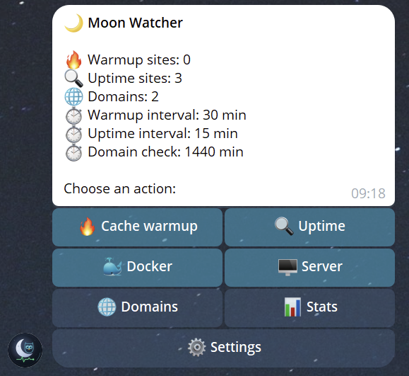
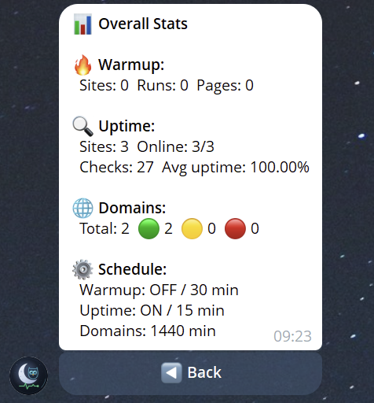
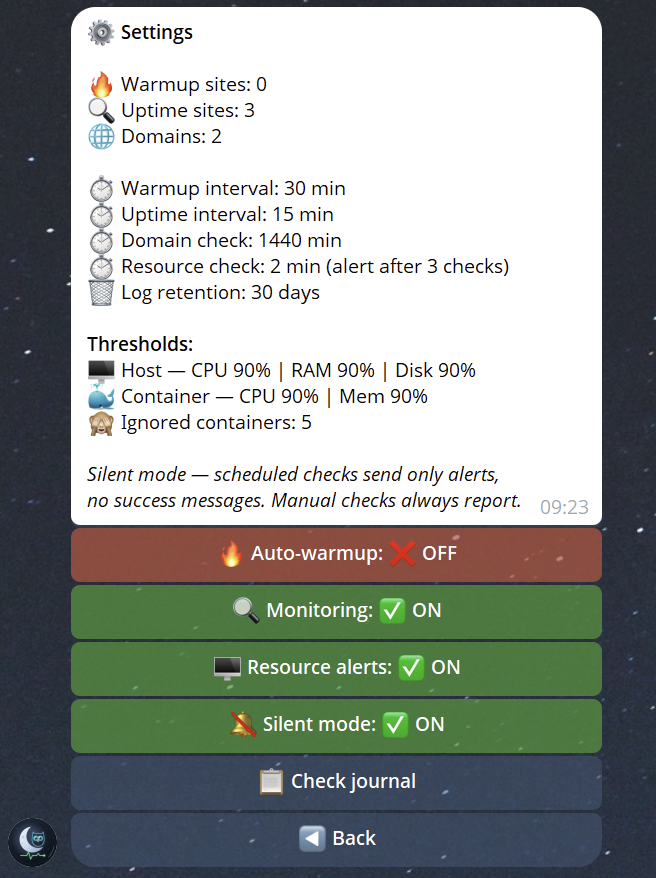

<p align="center">
  
</p>

<h1 align="center">Moon Watcher</h1>

A lightweight Telegram bot that watches your websites and your VPS. One `docker compose up`, one chat for all alerts.

## Features

- **Uptime monitoring** — periodic checks, failures confirmed by re-checking (no alerts on a single blip), incident log with downtime duration
- **Cache warmup** — walks `sitemap.xml` and visits every page to keep your cache hot
- **SSL certificates** — expiry alerts (14 / 7 / 3 / 1 days) and an alert when browsers would stop trusting the certificate (expired, wrong host name, broken chain), for every https site
- **Domain expiry (RDAP, WHOIS as fallback)** — multi-level alerts (30 / 14 / 7 / 3 / 1 days and expired), reset automatically after renewal
- **Docker monitoring** — container state, healthchecks, restarts (even between checks), CPU / RAM / network / IO / PIDs, alerts on crash and on sustained high usage
- **Server resources** — CPU, RAM, swap, disk, load average, uptime, 24h history
- **Telegram control panel** — inline buttons, manual checks, pauses with a time limit, silent mode (only problems are reported)
- PostgreSQL storage with automatic migrations and retention cleanup

<p align="center">
  
  
  
</p>

## Quick start

```bash
git clone https://github.com/cyborgmachine/moon-watcher.git && cd moon-watcher
cp .env.example .env        # fill in the token, admin IDs, sites, DB_PASSWORD, DOCKER_GID
docker compose up -d --build
```

Then send `/start` to your bot.

- `TELEGRAM_BOT_TOKEN` — from [@BotFather](https://t.me/BotFather)
- `ADMIN_USER_IDS` — your Telegram user ID(s); only these users can use the bot
- `DOCKER_GID` — `stat -c '%g' /var/run/docker.sock`
- `DB_PASSWORD` — required, pick a long random value

Logs: `docker compose logs -f moon-watcher`

## Configuration

All settings are environment variables, see [`.env.example`](.env.example) for the full list.

| Variable                                              | Default                                     | Description                                                                                                           |
| ----------------------------------------------------- | ------------------------------------------- | --------------------------------------------------------------------------------------------------------------------- |
| `WARMUP_SITES` / `UPTIME_SITES` / `MONITORED_DOMAINS` | —                                           | Comma-separated lists                                                                                                 |
| `UPTIME_CHECK_INTERVAL`                               | 15                                          | Minutes between uptime checks                                                                                         |
| `UPTIME_FAIL_THRESHOLD`                               | 2                                           | Consecutive failed checks before a site is reported DOWN (1 = immediately)                                            |
| `UPTIME_RETRY_DELAY`                                  | 30                                          | Seconds between confirmation checks                                                                                   |
| `UPTIME_CONCURRENCY`                                  | 5                                           | Sites checked in parallel                                                                                             |
| `WARMUP_INTERVAL`                                     | 30                                          | Minutes between warmups                                                                                               |
| `DOMAIN_CHECK_INTERVAL`                               | 1440                                        | Minutes between domain expiry checks                                                                                  |
| `DOMAIN_ALERT_DAYS`                                   | 30,14,7,3,1                                 | Expiry alert thresholds (days)                                                                                        |
| `DOMAIN_ERROR_ALERT_AFTER`                            | 3                                           | Warn once after this many lookups in a row return no expiry date                                                      |
| `SSL_MONITORING`                                      | true                                        | Check the certificates of all https sites from `UPTIME_SITES` / `WARMUP_SITES`                                        |
| `SSL_HOSTS`                                           | —                                           | Extra hosts to check, `host` or `host:port` (mail server, API on another port…)                                       |
| `SSL_CHECK_INTERVAL`                                  | 720                                         | Minutes between certificate checks                                                                                    |
| `SSL_ALERT_DAYS`                                      | 14,7,3,1                                    | Expiry alert thresholds (days)                                                                                        |
| `ALERT_COOLDOWN`                                      | 900                                         | Seconds; throttles _repeating_ alerts (resource usage, restart loops). Down/up and expiry alerts are never suppressed |
| `DOCKER_MONITORING`                                   | true                                        | Container monitoring (needs the Docker socket)                                                                        |
| `IGNORED_DOCKER_CONTAINERS`                           | —                                           | Names to skip, wildcards allowed (`tmp-*`)                                                                            |
| `RESOURCE_CHECK_INTERVAL` / `RESOURCE_ALERT_CHECKS`   | 2 / 3                                       | Check every N minutes; alert after N consecutive breaches                                                             |
| `THRESHOLD_CPU` / `RAM` / `DISK`                      | 90                                          | Host thresholds (%)                                                                                                   |
| `THRESHOLD_CONTAINER_CPU` / `MEM`                     | 90                                          | Container thresholds (%)                                                                                              |
| `LOG_RETENTION_DAYS`                                  | 30                                          | Check history older than this is deleted                                                                              |
| `METRICS_RETENTION_DAYS`                              | 3                                           | Host / container metrics older than this are deleted                                                                  |
| `USER_AGENT`                                          | `Mozilla/5.0 (compatible; MoonWatcher/x.y)` | Sent with every request                                                                                               |

## Project layout

```
src/moon_watcher/
├── app.py              startup, watchdog, wiring
├── handlers.py         Telegram command and button routing
├── jobs.py             scheduled work (also started from buttons)
├── scheduler.py        job runner: runs on start, interval counted from the end of a run, stuck-job alerts
├── settings.py         pause / silent switches, saved in the database
├── store.py            key/value state that survives a restart
├── notifier.py         Telegram sender: cooldowns, grouping of alert bursts, rate limits
├── config.py           environment variables
├── database.py         PostgreSQL layer + migration runner
├── migrations/         numbered SQL files, applied automatically
├── monitors/           uptime, domain, rdap, tls, docker_monitor, system, cache_warmer
├── ui/                 screens: main, sites, docker
└── utils/              fmt (formatting), thresholds (sustained-threshold tracker), paging
docker/                 Dockerfile and entrypoint
tests/                  pytest suite (no Docker daemon needed, database tests are opt-in)
```

## Development

```bash
pip install -r requirements-dev.txt
pytest -q
ruff check .
```

The database tests run against a real PostgreSQL and are skipped unless `TEST_DB_HOST` is set
(see `tests/test_database.py`; the test database gets wiped):

```bash
TEST_DB_HOST=127.0.0.1 TEST_DB_PORT=5432 TEST_DB_USER=watcher TEST_DB_PASSWORD=... pytest -q
```

To change the schema, add `src/moon_watcher/migrations/003_<name>.sql`; it is applied once on the next start.

## How it behaves when things break

- **Database down**: down/recovery alerts still go out, open incidents are kept in memory and written once the
  database is back. Screens that need history say so instead of hanging. Every query has a 15 s timeout.
- **Bot restart**: all checks run within a minute of the start. Open incidents, Docker container states,
  already-sent resource alerts, cooldowns and pauses are restored, so nothing is reported twice and recoveries
  still arrive. If the bot was down for more than 3 minutes, the startup message says for how long.
- **Hung process**: a watchdog exits the process if the Telegram loop or the scheduler stop ticking for 5 minutes,
  and `restart: unless-stopped` brings it back.
- **Stuck check**: if a check runs much longer than it should, you get one message about it; the next run starts
  only after the current one finishes.
- **Many alerts at once**: alerts raised within a few seconds of each other are sent as one message,
  Telegram rate limits are respected.

## Known limitations

- Domain dates come from RDAP where the TLD has it (.dev, .app, .com ...) and from `python-whois` otherwise; WHOIS parsing is unreliable for some ccTLDs and registries rate-limit queries
- The bot cannot report its own death or a dead VPS — pair it with an external heartbeat service if that matters
- Sites and domains are configured through `.env` (restart required)
- Monitoring can be paused from Settings for 1 / 6 / 24 hours or until resumed; pauses survive a restart and are shown
  in the main menu and in the startup message

## Security

Docker monitoring needs access to the Docker socket, which is root-equivalent. Read [SECURITY.md](SECURITY.md) before deploying.

## License

[MIT](LICENSE)
